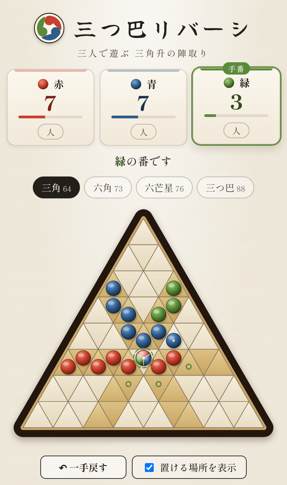

# 三つ巴リバーシ

三人で遊ぶ、三角マスのリバーシです。
赤・青・緑の三人が順番に石を置き、相手の石を挟んで自分の色に変えていきます。

<p align="center">
  
</p>

## 特徴

- **三人対戦**：赤 → 青 → 緑 の順に打つ、三人専用のリバーシです。
- **三角マスの盤**：挟める向きは、横・右上がりの斜め・左上がりの斜めの3本の線（前後で計6方向）です。
- **真ん中の三色の石**：盤の中心にある石は「いま置く人の色」として扱われ、だれでも挟む端に使えます。この石は絶対に色が変わりません。
- **4種類の盤**：三角（64マス）・六角（73マス）・六芒星（76マス）・三つ巴（88マス）。どの盤も中心を軸に120°回すと同じ形になるので、三人とも公平です。
- **CPU対戦**：色ごとに「人」と「CPU」を切り替えられます。一人でも、二人でも遊べます。
- **便利な機能**：一手戻す、置ける場所の表示、対局中の「はじめから」の押し間違い防止（2回押しで確定）。

## あそびかた

1. 赤 → 青 → 緑 の順に、自分の色の石を1つ置きます。
2. 置いた石と自分の石で、ほかの石をまっすぐ挟むと、挟んだ石がすべて自分の色に変わります。ほかの2人の石が混ざっていても、まとめて挟めます。
3. 真ん中の三色の石は、いま置く人の色として扱います。自分の石のかわりに挟む端として使えます。挟んで返すことはできず、だれの得点にも数えません。
4. 盤の金色のマスは、真ん中の石と同じ線の上にあるマスです。ここでは真ん中の石を端にして挟めます。
5. 石を1つも返せない場所には置けません。置ける場所がない人はパスです。
6. 三人とも置けなくなったら終わりです。最後に石が一番多い人の勝ちです。

## 起動方法

ビルドもインストールも不要です。`index.html` をブラウザで開くだけで遊べます。

```bash
git clone https://github.com/<ユーザー名>/mitsudomoe-reversi.git
cd mitsudomoe-reversi
open index.html        # macOS（Windows は index.html をダブルクリック）
```

### GitHub Pages で公開する

1. リポジトリの **Settings → Pages** を開きます。
2. **Source** で `Deploy from a branch` を選び、ブランチ `main`、フォルダ `/ (root)` を指定して保存します。
3. 数分後、`https://<ユーザー名>.github.io/mitsudomoe-reversi/` で遊べるようになります。

## ファイル構成

```
.
├── index.html      # ゲーム本体（HTML・CSS・JavaScript をこの1ファイルにまとめています）
├── screenshot.png  # README 用の画面画像
└── README.md
```

## 動作環境

- Chrome / Edge / Safari / Firefox の最新版（パソコン・スマホ）
- 文字は Google Fonts（しっぽり明朝・佑字粛）を読み込みます。オフラインでも遊べますが、その場合は端末の明朝体で表示されます。
- 選んだ盤の形と見た目は、ブラウザ（localStorage）に保存され、次に開いたときも残ります。

## 技術メモ

- 外部ライブラリは使わず、素の JavaScript と SVG で描いています。
- 三角マスは `(行 r, 列 x)` の座標で表し、`(x + r)` が偶数なら上向き、奇数なら下向きのマスです。
- 6方向の移動は `DIRS` 配列にまとめてあり、どの方向も辺でつながったマスを一直線にたどります。
- 盤の形は `SHAPES` にマスの座標の一覧として入っています。新しい形を追加するときは、ここに座標の一覧を足し、`SHAPE_INFO` に名前を加えてください。初期配置（`4,0` `5,-1` `5,0` `5,1`）が盤に含まれ、中心 `5,0` のまわりで120°回転しても同じ形になるようにすると、三人で公平な盤になります。

<details>
<summary>隠し要素（ネタバレ）</summary>

ページの一番下、「はじめから」のさらに下に、うっすらと「見た目」の切り替えがあります。
「三国志」を選ぶと、赤＝呉、青＝魏、緑＝蜀の駒になり、真ん中の石は「漢」の金印になります。勝者が決まると「天下統一」と表示されます。

</details>

## 作者

悠
